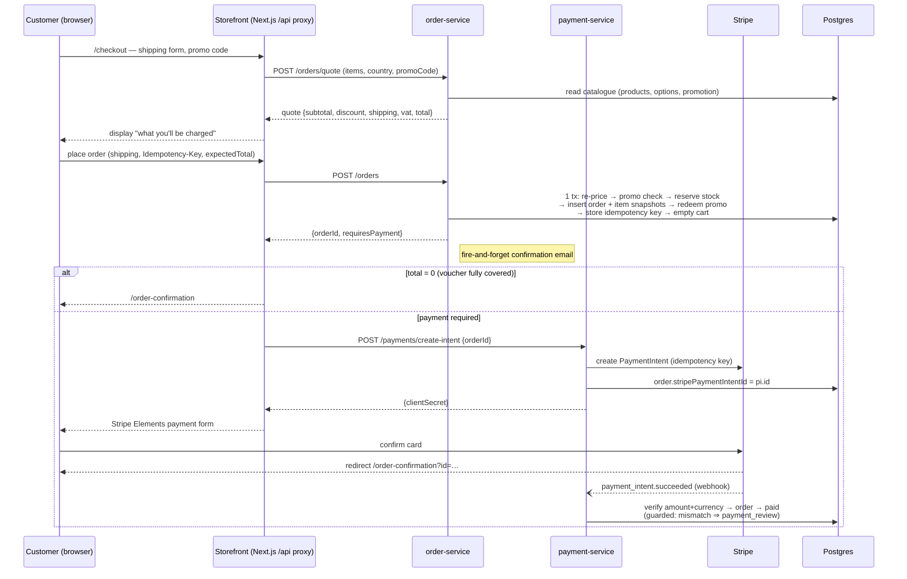
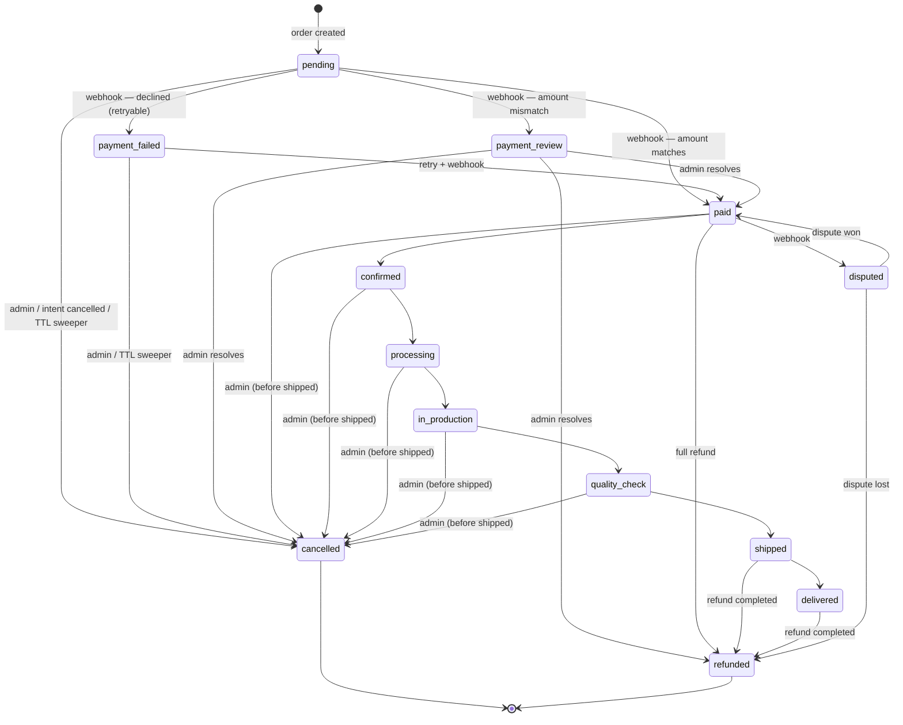
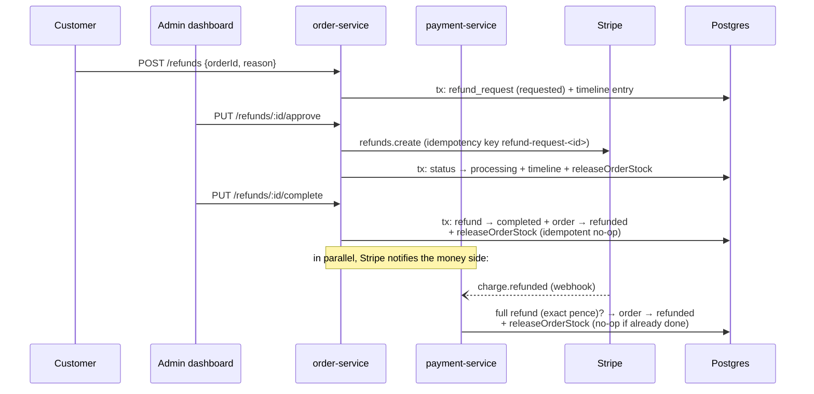

# Suit Masters — Complete Workflows

Reference for every end-to-end workflow in the system: the customer purchase
journey, the order/payment lifecycle, refunds, the admin back office, and the
cross-cutting platform mechanics (pricing, inventory, idempotency, dev/ops).

Key invariants that hold across all of them:

- **All money is integer minor units (pence).** See `packages/pricing/src/money.ts`.
- **Prices always come from the catalogue (the database), never from the
  client.** Every cart line, quote, order and refund is re-priced server-side,
  so a tampered cart cannot change what is charged.
- **Stock is reserved when an order is created — before payment** — and is
  returned to sale when the order is cancelled, its payment dies, or it is
  refunded.

---

## 1. System overview

```
apps/frontend (Next.js storefront, :3000)   ──▶  /api/* proxy routes (cookie forwarded)
apps/admin    (Next.js dashboard,  :3002)   ──▶  direct service calls (Bearer token)

services/product-service (:4000)  catalog, categories, collections, measurements, promotions, users
services/cart-service    (:4001)  cart CRUD + local/server sync
services/payment-service (:4002)  Stripe PaymentIntents, webhooks, reservation expiry
services/order-service   (:4003)  quoting, order creation, status, refunds
packages/  auth (Better Auth + Hono middleware) · database (Drizzle schema, inventory,
           promotions) · pricing (money/VAT/shipping/quote) · validation (zod) ·
           error-handling · testing (fake Stripe, e2e harness) · types
```

> Port note: `docker-compose.yml` is authoritative for containerised ports
> (product 4000, cart 4001, payment 4002, order 4003). Local dev service
> URLs come from env (`*_SERVICE_URL` / `NEXT_PUBLIC_*_SERVICE_URL`).

---

## 2. Customer workflow (storefront)

### 2.1 Authentication

- Provider: **Better Auth** (`packages/auth/src/auth.ts`), email + password,
  sessions stored in Postgres via the Drizzle adapter.
- The storefront uses **session cookies**; the Hono services accept the same
  session as a **Bearer token** (Better Auth `bearer()` plugin) and validate it
  with the `getUser` middleware (`packages/auth/src/middleware/authMiddleware.ts`).
- `requireRole("ADMIN")` is the role gate used on every admin route.
- Password reset: `sendResetPassword` hook emails a link (Resend) to
  `/reset-password?token=…` — custom UI, not Better Auth's default page.
- Frontend pages call `useSession()` (`@repo/auth/client`); unauthenticated
  visitors are redirected to `/login?redirect=…` at checkout.

### 2.2 Browsing the catalog (public)

| Route (product-service) | Purpose |
|---|---|
| `GET /products` | List active products; filters `?category=<slug>&search=<q>` |
| `GET /products/suggestions?q=` | Autocomplete (products + categories) |
| `GET /products/:slug` | Product detail **with its category's customization groups and options** (batched to avoid N+1) |
| `GET /categories`, `GET /categories/:slug`, `GET /categories/:parentSlug/:childSlug/products` | Navigation |
| `GET /collections`, `GET /collections/:slug`, `GET /collections/:slug/:productSlug` | Editorial collections |

Frontend pages: home, `/shop/[category]`, `/collections/[slug]`,
`/products/[slug]`. Search bar hits `/products/suggestions`.

### 2.3 Configuring a suit

Page: `/products/[slug]/configure` → `apps/frontend/app/components/Configurator.tsx`
plus the 3D viewer (`components/configurator/3d/*`: `SuitModel`, `SuitViewer`,
`CameraRig`, mesh mapping per option).

- Option data model: `customization_category` → `customization_group`
  (isRequired, displayOrder) → `customization_option`
  (`value`, `priceDelta`, `thumbnailUrl`, `imageUrl`, `texture`,
  `factoryCode`). Options belong to the **category**, so every product in the
  category shares the same option set.
- Selections are kept in `useConfiguratorStore` (Zustand):
  `selections` (group → option), `activeStep`, plus `globalMeasurements`
  (height, chest, waist, hips, shoulder, inseam) in the cart store.
- **Measurement profiles** (reusable, e.g. "my suit size"):
  - `GET /measurements/definitions` (public) — the measurement fields and video guides;
  - `GET|POST /measurements/profiles`, `PUT|DELETE /measurements/profiles/:id` (authed, own profiles only) —
    `services/product-service/src/routes/measurements.routes.ts`.
  - Attached to a cart item as `measurements` and snapshotted onto the order line.
- Price preview = base price + Σ priceDelta of selected options (display only;
  the server re-prices at cart/checkout time).

### 2.4 Cart (local + server)

Store: `apps/frontend/app/stores/useCartStore.ts` (Zustand, persisted as
`cart-storage` v1 in localStorage, with a pounds→pence migration for v0).

1. **Guest cart** — everything works in localStorage; `addToCart` merges
   quantity when the same product + same custom options are added again.
2. **Login sync** — `syncWithServer()`:
   - fetch the server cart (`GET /api/cart` → cart-service `GET /cart`);
   - merge server items into local state;
   - push local items via `PUT /api/cart {action:"sync"}` → cart-service
     `POST /sync`, which **re-prices every line from the catalogue** (client
     prices are ignored), creates a `product_configuration` snapshot per
     custom line, and merges standard lines by product.
3. **Ongoing changes** — fire-and-forget pushes:
   - `pushToServer` → `POST /api/cart` → cart-service `POST /add`
     (find-or-create cart, price from catalogue, merge quantities);
   - `removeFromCart` → `DELETE /api/cart?itemId=`;
   - `updateQuantity` → `PUT /api/cart {itemId, quantity}`;
   - `clearCart` → `DELETE /api/cart?clear=true`.
4. **Server cart semantics** (cart-service): one `shopping_cart` per user;
   items carry `productId`, optional `configurationId`, `price` (unit, pence),
   `quantity`. Adding a config to a cart is the same code path as
   `/design/save` (price → save `product_configuration` → upsert cart item).

### 2.5 Checkout

Page: `apps/frontend/app/checkout/page.tsx` (requires auth; pre-fills name/
email from the session).

**Step 1 — Shipping & quote**

- Shipping form validated client-side (name/email/phone/address/city/postal/
  country); country restricted to `SHIPPING_COUNTRIES`
  (`packages/pricing/src/index.ts`: UK / Europe / World zones).
- Debounced (250 ms) `POST /api/orders/quote` → order-service
  `POST /orders/quote` → `priceCheckout()`
  (`services/order-service/src/services/pricing.ts`):
  1. country must be a shipping destination, else `UNSUPPORTED_COUNTRY`;
  2. every product must exist and be active, else `PRODUCT_UNAVAILABLE`;
  3. price each line: base price + matching category options (unmatched
     selections become free-text tailor `notes`, not prices);
  4. promo: `checkPromotion()` validates code/active window/max redemptions/
     user eligibility/category scope; errors surface as `promoError`;
  5. `quote()` computes subtotal, discount (capped), export VAT relief
     (non-GB orders are zero-rated, relief shown), shipping by zone (free at
     £200+ or via `free_shipping` promo), VAT-inclusive total.
- The displayed quote **is** what will be charged: order creation passes
  `expectedTotal` and rejects with `409 PRICE_CHANGED` (+ fresh quote) if the
  catalogue moved.

**Step 2 — Place order**

`POST /api/orders` (forwards cookie + `Idempotency-Key`) → order-service
`POST /orders`. The idempotency key is one UUID per distinct
(bag + shipping details + promo) fingerprint, so resubmissions return the
same order.

Inside **one transaction** (`orderRoutes.ts`):

1. Re-price via `priceCheckout` (authoritative; see above).
2. Promo checks: invalid code → `409 PROMO_INVALID`; exhausted redemption
   counter → `409 PROMO_INVALID`.
3. `expectedTotal` mismatch → `409 PRICE_CHANGED` with the new quote.
4. **Reserve stock** for every line, products sorted by id to keep lock
   ordering deadlock-free. `reserveStock()`
   (`packages/database/src/inventory.ts`): `SELECT … FOR UPDATE` on the SKU
   with the most stock, plus a re-check `UPDATE` that no-ops on short stock —
   concurrent checkouts can't oversell. All shortfalls are collected and
   returned as `409 OUT_OF_STOCK` with per-item available counts.
5. Insert `shop_order` (status `paid` when total is 0, else `pending`) and
   `order_items` with snapshots: name, unit price, `priceAtPurchase`,
   customization options + notes + size, measurements.
6. Redeem the promotion (atomic counter inside the same transaction).
7. Record the idempotency key (`key + userId → orderId`).
8. Empty the user's saved cart (the order now holds it).

After commit: fire-and-forget **confirmation email** (order lines,
customization summary, address, estimated delivery +14 days, tailor note).
Response: `{ orderId, reused, requiresPayment }`.

**Step 3 — Payment**

- `requiresPayment === false` (fully discounted) → straight to
  `/order-confirmation?id=…`.
- Otherwise `POST /api/payments/create-intent` → payment-service
  `POST /payments/create-intent` (`paymentRoutes.ts`):
  - owner (or ADMIN) only; order must be `pending` or `payment_failed`;
  - reuses a live existing PaymentIntent when amount+currency match (one
    order, one live intent); a stale-amount intent is cancelled first;
  - creates the intent with idempotency key
    `order-<id>-intent-<amount>-<currency>`, stores `stripePaymentIntentId`
    on the order, returns `clientSecret`.
- Stripe Elements + `PaymentForm` confirms the payment; success redirects to
  `/order-confirmation?id=…`. If the page closes first, the **webhook**
  (below) is the source of truth.
- The 30-minute reservation clock starts at order creation; an abandoned
  payment is cancelled by the sweeper (§4.2), returning stock.

### 2.6 Post-purchase

- `/order-confirmation` — order summary + "view your orders".
- `/account` — order history (`GET /orders`), each order links to
  `/account/orders/[id]` (line items, customization, status).
- `/account/refunds` — list of refund requests and start a new one (§5).

---

## 3. Order lifecycle (state machine)

Defined in `services/order-service/src/domain/orderStatus.ts`; every admin
status change is validated against it.

```
pending ──(Stripe webhook)──▶ paid ─▶ confirmed ─▶ processing ─▶ in_production
   │                            │                                  │
   ├──▶ payment_failed          └──────────────────────────────────┤
   │                       (fulfilment flow, forward only)          ▼
   ├──▶ payment_review          quality_check ─▶ shipped ─▶ delivered
   ├──▶ disputed
   └──▶ cancelled / refunded      (terminal; stock released)
```

Rules:

- **Payment states** (`pending`, `payment_failed`, `payment_review`,
  `disputed`) are set by **Stripe webhooks**; from `pending`/
  `payment_failed` an admin may only move to `cancelled`. `payment_failed`
  stays payable — the customer can retry the same PaymentIntent.
- **Fulfilment flow** (`paid → confirmed → processing → in_production →
  quality_check → shipped → delivered`) moves forward only, skipping allowed,
  going back never. Cancellation is possible up to (but not after) `shipped`.
- `payment_review` (amount mismatch flagged by the webhook) and `disputed`
  are resolved by an admin: to `paid`, `refunded`, or (for review)
  `cancelled`.
- Terminal statuses (`cancelled`, `refunded`) return the reserved stock via
  the idempotent `releaseOrderStock`.
- Admin status updates: `PUT /orders/:id/status` (with optional
  `trackingNumber` / `trackingCarrier`), which updates the order in a
  transaction, releases stock on terminal states, and sends a **status email**
  to the customer (fire-and-forget).

---

## 4. Payment & webhook workflow

### 4.1 Stripe webhooks

`services/payment-service/src/routes/webhook.ts` — `POST /webhook`:
verify `stripe-signature` with `STRIPE_WEBHOOK_SECRET`, then dispatch:

| Event | Handler | Effect on the order |
|---|---|---|
| `payment_intent.succeeded` | `handlePaymentIntentSucceeded` | Amount **and** currency must equal the order exactly, else `payment_review` (human resolves). Otherwise `pending/payment_failed → paid`, guarded on status so a late webhook can't revive a cancelled order. |
| `payment_intent.payment_failed` | `handlePaymentIntentFailed` | → `payment_failed` (retryable) |
| `payment_intent.canceled` | `handlePaymentIntentCanceled` | Cancel the unpaid order + release stock |
| `payment_intent.amount_capturable_updated` | — | Log only |
| `charge.succeeded` / `charge.failed` | — | Log with order metadata |
| `charge.refunded` | `handleChargeRefunded` | Full refund (exact pence) → `refunded` + stock release; partial refunds are logged only |
| `charge.dispute.created` | `handleDisputeCreated` | → `disputed` |
| `charge.dispute.closed` | `handleDisputeClosed` | won → `paid`; lost → `refunded` |
| `checkout.session.completed` | `handleCheckoutSessionCompleted` | → `paid` |
| `checkout.session.expired` | `handleCheckoutSessionExpired` | Cancel unpaid order + release stock |
| `invoice.payment_*` | — | Log only |

`cancelUnpaidOrder` (shared by the handlers and the sweeper) does a
conditional `UPDATE … WHERE status IN (pending, payment_failed)` in a
transaction, then `releaseOrderStock` — safe to run concurrently/repeatedly.

### 4.2 Reservation expiry sweeper

`services/payment-service/src/jobs/expireReservations.ts` — every 5 minutes:

1. Find payable orders older than `RESERVATION_TTL_MINUTES` (default 30) that
   haven't released stock yet (max 100 per sweep).
2. For each: if it has a PaymentIntent that is neither `succeeded` nor
   `processing`, cancel it on Stripe (so the customer can't pay for stock
   that has gone back on sale); if Stripe refuses, leave the order for the
   webhook to settle.
3. `cancelUnpaidOrder` → `cancelled` + stock returned.

---

## 5. Refund / return workflow

Customer side (order-service `refundRoutes.ts`):

1. `POST /refunds { orderId, reason, description?, quantity? }`
   - order must belong to the user and be `shipped` or `delivered`;
   - reasons: `wrong_size | defective | not_as_described | changed_mind |
     late_delivery | other`;
   - inserts `refund_request` (status `requested`, amount = order total) plus
     a `refund_timeline` entry in one transaction.
2. `GET /refunds` / `GET /refunds/:id` — the customer's requests with
   timeline.

Admin side:

| Endpoint | Effect |
|---|---|
| `GET /refunds/admin/all` | List all requests |
| `PUT /refunds/:id/approve` | **Stripe refund first** (idempotency key `refund-request-<id>`), then transactionally: status `processing`, timeline, `releaseOrderStock`. Amount must be ≤ order total. |
| `PUT /refunds/:id/reject` | → `rejected` + timeline (only from `requested`) |
| `PUT /refunds/:id/complete` | → `completed`, order → `refunded`, idempotent stock release |

Refund state flow: `requested → approved/processing → completed` or
`requested → rejected`. The `charge.refunded` webhook independently closes the
order and returns stock, so the money-side and bookkeeping-side stay
consistent.

---

## 6. Admin workflow (dashboard)

Access: `apps/admin/middleware.ts` — every non-public path requires a valid
Better Auth session **and** `roles === "ADMIN"` (else redirect to
`/login?redirect=…`). Service calls carry the session as a Bearer token;
admin endpoints enforce `requireRole("ADMIN")` again server-side.

**Catalog management** (product-service `routes/admin/*`):

- Products: `GET /products/admin/all`, `GET /products/admin/form-options`
  (dropdown data for the form), `GET /products/admin/:id`, `POST /products`,
  `PATCH /products/:id`, `DELETE /products/:id` (soft), `PATCH
  /products/:id/stock` (SKU stock levels). Products are `STANDARD` or
  `CUSTOM` (customizable via their category's option groups).
- Categories: list / create / update / delete.
- Collections: list / create / update / delete.

**Orders**:

- `GET /orders/admin/all` (last 100), `GET /orders/:id` (any order, with
  items).
- Status control: `PUT /orders/:id/status` per the state machine (§3) with
  tracking number/carrier → status email to the customer.

**Payments & refunds**: payment listing (`/payments`), refund queue
(`/refunds/admin/all`) and the approve / reject / complete actions (§5).

**Users**: `GET /users` (admin list), add/update users and roles (the admin
app's user management pages).

**Promotions** (product-service `promotions.routes.ts`):

- Admin CRUD: `GET /promotions/all`, `POST /promotions`, `PUT /promotions/:id`,
  `DELETE /promotions/:id`.
- Types: `percentage` (optional `maxDiscount`), `fixed_amount`,
  `free_shipping`; scopes: category-limited, date windows, max redemptions
  (global and per user).
- Public `POST /promotions/validate` powers the checkout promo box; the same
  checks run again inside the order transaction at purchase time.

---

## 7. Cross-cutting platform workflows

### 7.1 Pricing rules (`packages/pricing`)

- Money: integer minor units (pence); `assertMinorUnits` guards every
  computation; `percentOf` uses exact integer math.
- VAT: UK standard 20% kept as the rational `1/5` for exactness. Catalogue
  prices are **VAT-inclusive** (UK consumer law); UK orders pay the shown
  price and the receipt states `vatIncluded`; non-GB orders are **exports**,
  zero-rated, with `exportVatRelief` removed from the total (import duty may
  still apply to the buyer).
- Shipping zones: UK £5, Europe £12, World £20; free above £200 of goods or
  with a `free_shipping` promo.
- Discounts are capped so they can never exceed the amount they apply to;
  category-scoped promos discount only the lines in that category.
- One `quote()` implementation is shared by the storefront (display) and
  order-service (authoritative charge) — what the customer sees is what is
  charged, with `PRICE_CHANGED` as the safety net.

### 7.2 Inventory lifecycle (`packages/database/src/inventory.ts`)

```
on sale ──order created──▶ reserved (stock decremented on a specific SKU)
reserved ──paid/fulfilled──▶ sold
reserved ──cancelled / payment cancelled or expired / refunded──▶ released (idempotent, via stockReleasedAt claim)
```

- `reserveStock`: one SKU per line — the active SKU with the most stock,
  locked with `FOR UPDATE` and re-checked in the `UPDATE`, so stock never
  goes negative under concurrency. Products with no active SKUs are
  made-to-order and skip stock control.
- `releaseOrderStock`: claims `stockReleasedAt` first, so only the first
  release ever restores stock; later calls (webhook retries, refund
  completion after admin approval) are no-ops.

### 7.3 Idempotency

- Checkout: `Idempotency-Key` header, stored per user; replays return the
  original `orderId` with `reused: true`.
- Stripe PaymentIntent: one per order/amount (`order-<id>-intent-<amount>-<currency>`);
  retries reuse the live intent.
- Stripe refunds: one per refund request (`refund-request-<id>`).
- Stock release: `stockReleasedAt` claim (§7.2).

### 7.4 Auth & authorisation

- Better Auth sessions (Postgres-backed) + `bearer()` plugin for services.
- `getUser` → 401 without a session; `requireRole("ADMIN")` → 403 otherwise.
- Ownership checks are in every customer route: carts, orders, refunds, and
  measurement profiles are scoped to the caller; admins are explicitly
  elevated where needed (any order, admin listings, promotion/catalog CRUD).

### 7.5 Error handling & observability

- Shared `@repo/error-handling`: `errorHandler` / `notFoundHandler`,
  structured request logging, Sentry init per service, `/health` routes with a
  live DB probe (`select 1`).
- Business rejections use typed errors + machine-readable codes
  (`PRICE_CHANGED`, `OUT_OF_STOCK`, `PROMO_INVALID`, `PRODUCT_UNAVAILABLE`,
  `UNSUPPORTED_COUNTRY`) so the storefront can react (e.g. show a fresh
  quote, list out-of-stock items).
- Emails (order confirmation, status updates, password reset) are
  fire-and-forget — a failed send never fails the underlying operation.

---

## 8. Development & operations workflows

### 8.1 Local development

- `npm run dev` — Turbo runs all workspaces (services, apps, packages).
- `docker compose up` — full stack in containers:
  `postgres` (health-checked) → `migrate` (one-shot `drizzle-kit migrate`,
  all services wait on it) → the four services (health-gated) → `frontend`
  and `admin` Next.js apps.
- `start-services.sh` — starts the four Hono services locally with per-port
  dedup, logs to `/tmp/<service>.log`.
- `npm run build | lint | check-types | test | test:e2e` — Turbo across all
  workspaces.

### 8.2 Database

- Drizzle ORM + Kit; migrations in `packages/database/drizzle/` (baseline +
  incremental), plus ad-hoc SQL scripts (`add-*.sql`,
  `create-*-table.sql`).
- Scripts: `seed.ts` (products/customization), `seed-measurements.ts`,
  `reset.ts` (clean slate), `migrate-money-to-minor-units.ts` (historical
  pounds→pence migration).
- Every container deploy and CI run applies pending migrations before
  serving traffic (compose `migrate` step; CI "Run database migrations" job).

### 8.3 Testing (see TESTING.md)

| Layer | Tool | Where | Command |
|---|---|---|---|
| Unit | Vitest | `packages/{pricing,validation,error-handling}`, order status domain | `npm test` |
| Integration (HTTP + real Postgres, isolated DB per run) | Vitest + Hono `app.request()` | `services/*/test` | `npm test` |
| End-to-end (browser, production builds) | Playwright | `apps/frontend/e2e`, `apps/admin/e2e` | `npm run test:e2e` |

- Integration tests use the **fake Stripe** server
  (`packages/testing/src/fake-stripe.ts`) and `sendStripeWebhook`
  (`packages/testing/src/stripe-webhook.ts`) to drive the full payment flow
  deterministically.
- E2E journeys: customer — browse → configure → checkout → pay; measurement
  profile save; out-of-stock checkout block. Admin — access control, product
  creation (pounds input), refund approval (Stripe refund + stock return
  verified).
- Each run creates and drops its own test database (`TEST_DATABASE_URL`), so
  tests never touch real data.

### 8.4 CI/CD (`.github/workflows`)

- `tests.yml` — the gate: lint/typecheck/build plus the full test suite on a
  real Postgres service container.
- `ci-cd.yml` — after validation: build & push images to GHCR → run Drizzle
  migrations against the shared database → trigger Render deploy hooks for
  cart/order/payment/product services → wait until each deployment is healthy.

---

## 9. Sequence diagrams

### 9.1 Checkout, payment, webhook



Abandoned-payment path (no webhook activity): after
`RESERVATION_TTL_MINUTES` (30) the sweeper cancels the PaymentIntent on
Stripe and the order, then releases stock (§4.2).

### 9.2 Order state machine



Fulfilment arrows may skip ahead (e.g. `paid → shipped`) but never go
backwards; any fulfilment state may also jump straight to `refunded` when a
full refund completes.

### 9.3 Refund flow



---

## 10. Quick reference: a purchase in one breath

```
browse → configure (options + measurements)
      → cart (localStorage; synced + repriced on login)
      → checkout: quote (server-priced, VAT/shipping/promo)
      → POST /orders: idempotent, transactional —
          repricing check → promo redemption → stock reservation →
          order + item snapshots → cart emptied → confirmation email
      → create PaymentIntent → Stripe Elements
      → webhook: paid (amount verified) | payment_failed | payment_review
      → admin fulfilment: confirmed → processing → in_production →
          quality_check → shipped → delivered   (status emails)
      → optional return: refund requested → approved (Stripe) → completed
          → order refunded → stock released
abandoned payment → 30-min sweeper cancels intent → order cancelled → stock released
```
